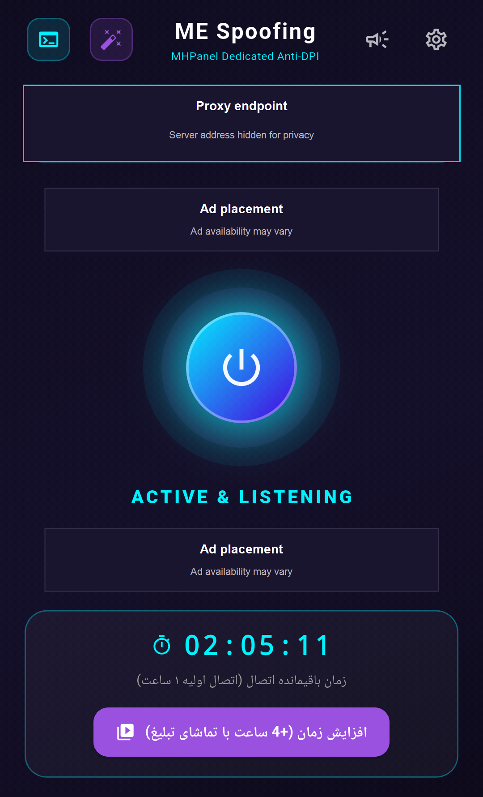

# ME Spoofing

ME Spoofing یک برنامهٔ اندرویدی برای اجرای کلاینت MHPanel به‌صورت پراکسی محلی TCP است. برای مسیریابی سراسری، پراکسی محلی را در کلاینت VPN سازگار مانند HAPP یا V2RayNG تنظیم کنید. این برنامه به‌تنهایی VPN اندروید ایجاد نمی‌کند.

> **نرم‌افزار اختصاصی:** این مخزن برای معرفی برنامه و انتشار فایل‌های رسمی نصب است. کد منبع برنامه در این مخزن منتشر نمی‌شود و پروژه اوپن‌سورس نیست.

## امکانات

- اجرای پراکسی محلی MHPanel روی `127.0.0.1` و پشتیبانی از چند پورت.
- سرویس Foreground برای ادامهٔ کار اتصال در پس‌زمینه.
- نمایش وضعیت اتصال، زمان باقیمانده، سرعت و حجم ترافیک و تعداد اتصال‌ها.
- اعلان وضعیت سرویس و پایان زمان اتصال.
- تبدیل پروفایل‌های پشتیبانی‌شده برای کلاینت‌های سازگار.
- امکان تمدید زمان با آگهی پاداشی، در صورت موجود بودن آگهی.

## راه‌اندازی

1. فایل نصب را از بخش [انتشارهای GitHub](https://github.com/t-51/ME-Spoofing/releases) دریافت کنید.
2. پروفایل پشتیبانی‌شده را در برنامه وارد و پورت‌های MHPanel را تنظیم کنید.
3. پراکسی را روشن کنید.
4. پروفایل تبدیل‌شده را در کلاینت VPN سازگار وارد و حالت مسیریابی را در همان کلاینت انتخاب کنید.
5. برای ادامهٔ کار در پس‌زمینه، اعلان دائمی برنامه را فعال نگه دارید و در صورت نیاز محدودیت باتری را بردارید.

این نسخه پراکسی محلی TCP فراهم می‌کند و پراکسی عمومی UDP نیست. کلاینت VPN مسئول انتخاب و مسیریابی ترافیک دستگاه است. توقف اجباری برنامه یا محدودیت‌های باتری سازندهٔ گوشی ممکن است سرویس پس‌زمینه را متوقف کند.

## دریافت برنامه

فایل‌های نصب رسمی در بخش [Releases](https://github.com/t-51/ME-Spoofing/releases) قرار می‌گیرند. اگر از معماری پردازندهٔ دستگاه مطمئن نیستید، **Universal APK** را انتخاب کنید؛ در غیر این صورت فایل Split متناسب با معماری دستگاه را بگیرید. فقط یکی از APKها را نصب کنید.

## پشتیبانی

- تلگرام: [@kigaping_fa](https://t.me/kigaping_fa)
- صفحهٔ برنامه و انتشارها: [t-51/ME-Spoofing](https://github.com/t-51/ME-Spoofing)
